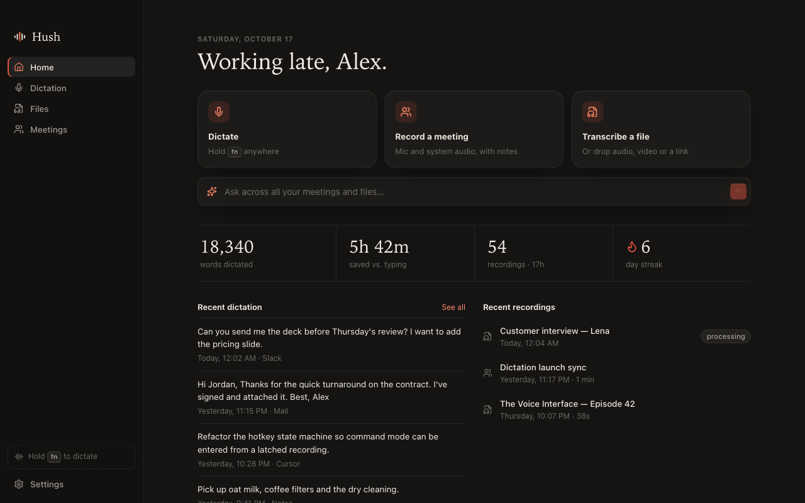
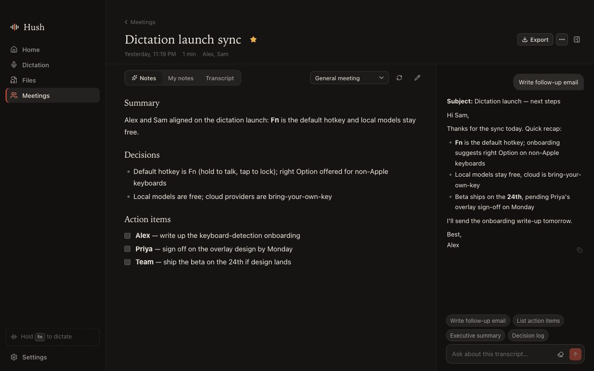
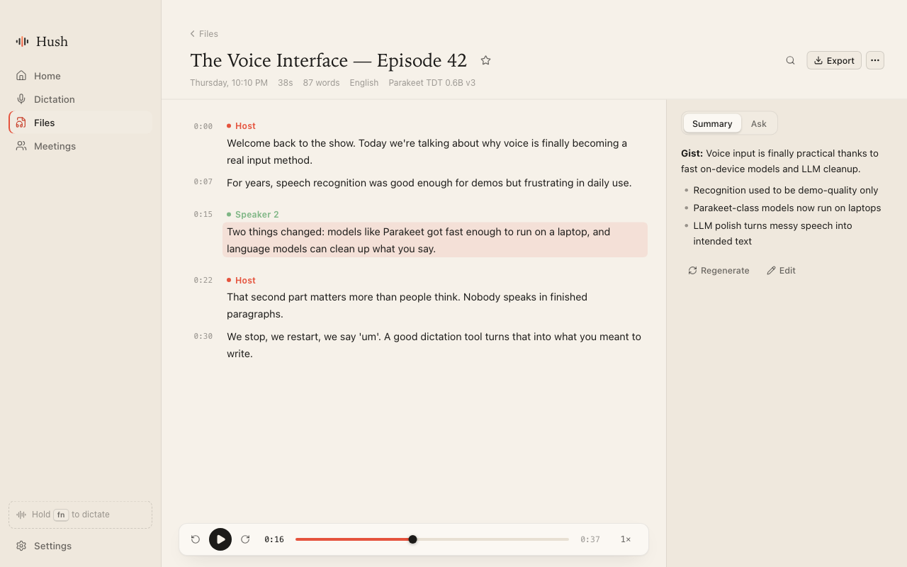
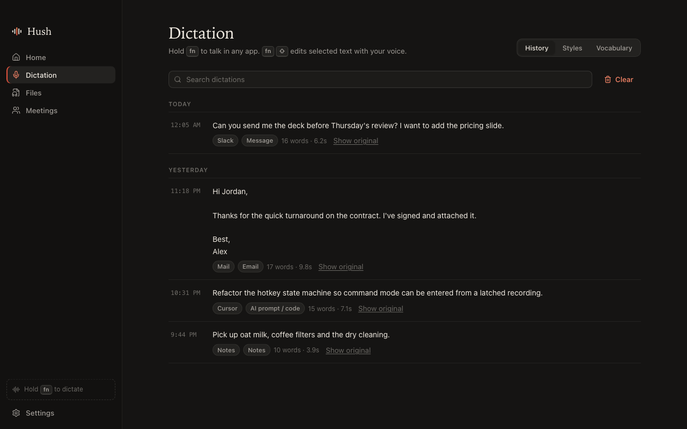
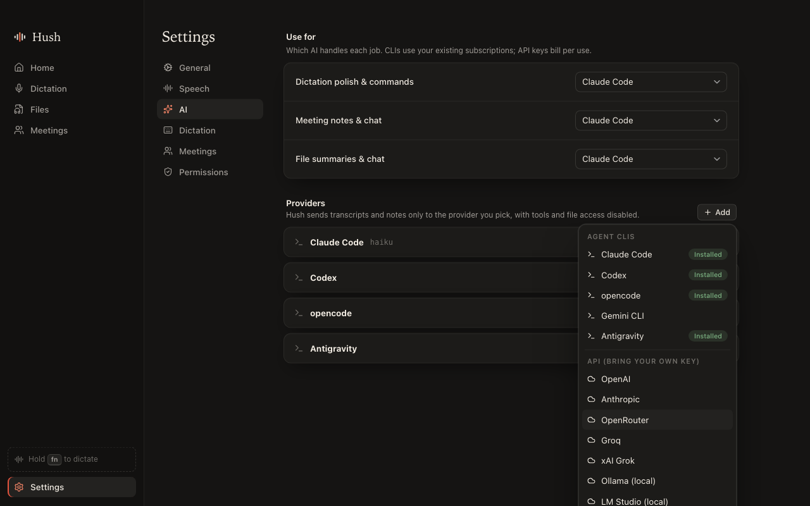
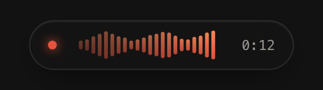

# Hush

[](https://github.com/madrazaldi/hush/actions/workflows/ci.yml)
[](https://github.com/madrazaldi/hush/releases/latest)
[](LICENSE)


Dictation, file transcription and meeting notes in one macOS app. Local-first:
speech runs on your Mac by default, and cloud speech or AI providers are opt-in.



- **Dictation**: hold <kbd>fn</kbd> anywhere and talk, then release to insert polished text.
  - A quick tap locks hands-free recording, and <kbd>Esc</kbd> cancels.
  - Command mode (<kbd>fn</kbd><kbd>⇧</kbd>) rewrites selected text by voice.
  - Per-app styles, vocabulary, replacements and searchable history.
- **Files**: drop audio or video, or paste a YouTube or podcast link, to get a timestamped, searchable transcript.
  - Synced playback and inline editing.
  - Speaker names, translation, summaries and chat.
  - Export to Markdown, TXT, SRT, VTT, CSV or JSON.
- **Meetings**: a notepad-first recorder that captures your mic ("Me") and system audio ("Them") without a bot joining the call.
  - Live transcript.
  - Enhanced notes from templates, chat and recipes (follow-up email, action items, and more).
  - Detects when Zoom, Meet, Teams and similar apps start using the mic.

| Meeting notes | File transcript |
|---|---|
|  |  |
| **Dictation history and styles** | **AI providers** |
|  |  |

<p align="center"></p>

## Install

1. Download `Hush_<version>_aarch64.dmg` from the [latest release](https://github.com/madrazaldi/hush/releases/latest).
2. Open it and drag **Hush** to Applications.
3. Release builds are not notarized unless the repository has Apple signing secrets, so macOS may say Hush "is damaged" or "can't be opened". Clear the quarantine flag once:

   ```sh
   xattr -dr com.apple.quarantine /Applications/Hush.app
   ```

4. Launch Hush. Onboarding grants permissions and downloads a speech model (Parakeet v3, about 740 MB, is recommended).

Optional: `brew install ffmpeg yt-dlp` for more media formats and link imports.

## Speech engines

| | |
|---|---|
| On-device | [transcribe-cpp](https://crates.io/crates/transcribe-cpp) on Metal, using Parakeet TDT v2/v3, Whisper (base → large v3 turbo), Moonshine, SenseVoice, Canary, Qwen3-ASR and others. Models download from Settings → Speech. |
| Cloud (BYOK) | OpenAI, Groq, Mistral, xAI Grok, Meta Muse, Deepgram, ElevenLabs, AssemblyAI, or any OpenAI-compatible `/audio/transcriptions` endpoint. |

Dictation, Files and Meetings each choose their own engine.

## AI providers

AI is used for dictation polish, command mode, meeting notes, summaries, translation, chat and recipes.

- **Agent CLIs** you're already signed in to: Claude Code, Codex, opencode, Gemini CLI, Antigravity.
  - They run with tools disabled or read-only, in an empty temporary directory, and without saving session history.
- **Bring your own key**: any Chat Completions, Responses or Anthropic Messages endpoint.
  - Presets: OpenAI, Anthropic, OpenRouter, Groq, xAI, Ollama, LM Studio.

## Development

Requirements: macOS 14.2 or later (for system audio capture), Rust, Node and pnpm, and CMake (to build transcribe-cpp). Optional: `ffmpeg` (more media formats) and `yt-dlp` (link imports).

```sh
pnpm install
pnpm tauri dev          # the app; Vite serves on 127.0.0.1:1427
pnpm tauri build        # release .app / .dmg
pnpm check              # svelte-check
cd src-tauri && cargo test --lib
```

[AGENTS.md](AGENTS.md) has the code layout and conventions for contributors (human or AI).

### CI and releases

- [CI](.github/workflows/ci.yml) runs on every push and pull request: `svelte-check` and the frontend build, then `cargo fmt --check`, `clippy -D warnings` and unit tests on macOS.
- [Release](.github/workflows/release.yml) runs when a `v*` tag is pushed. The tag must match `version` in `src-tauri/tauri.conf.json`. It builds the Apple Silicon `.dmg` with `tauri-action` and publishes a GitHub release. Tags with a `-` (e.g. `v0.2.0-beta.1`) become pre-releases.

  ```sh
  # bump version in src-tauri/tauri.conf.json, src-tauri/Cargo.toml and package.json, then:
  git tag v0.2.0 && git push origin v0.2.0
  ```

- To sign and notarize, add these repository secrets: `APPLE_CERTIFICATE` (base64 .p12), `APPLE_CERTIFICATE_PASSWORD`, `APPLE_SIGNING_IDENTITY`, `APPLE_ID`, `APPLE_PASSWORD` (app-specific password) and `APPLE_TEAM_ID`. Without them the build is ad-hoc signed.

### UI without the Rust side

`pnpm dev`, then open http://127.0.0.1:1427 in a browser. In dev builds, when the page runs outside Tauri, `src/lib/devmock` fakes the IPC with fixture data.

- Add `?onboarding` to the URL for the first-run flow, or `?live` for a meeting in progress.
- `window.__hushEmit(event, payload)` fires any backend event. For example, open `/overlay` and send `dictation:state` and `dictation:level`.

### Backend examples

```sh
cd src-tauri
cargo run --release --example transcribe -- talk.m4a [model-id]  # local STT on a file
cargo run --release --example llm                                # dictation cleanup via each installed CLI
cargo run --release --example systap                             # system-audio tap smoke test (prints levels)
```

## Permissions

- **Microphone**: dictation and meetings.
- **Accessibility**: the global hotkey and pasting into other apps.
- **System Audio Recording**: the other side of meetings. macOS asks the first time a meeting records. It's under Privacy & Security → Screen & System Audio Recording.

Data lives in `~/Library/Application Support/com.hush.app`: SQLite, audio, models, and `settings.json` (mode 0600, holds API keys).

See [DESIGN.md](DESIGN.md) for the research and architecture.

## License

[MIT](LICENSE)
